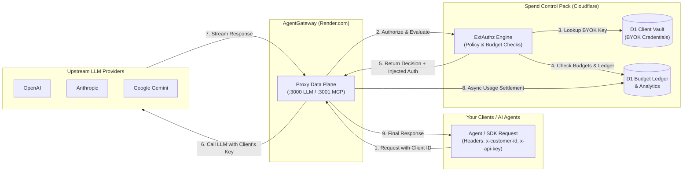

# Spend Control Pack & AgentGateway — User & Operations Guide

Welcome to the **Spend Control Pack (SCP)** integrated with **AgentGateway**. 

This system provides enterprise-grade AI infrastructure: **AgentGateway** serves as the high-throughput, low-latency infrastructure proxy on Render, while **Spend Control Pack** acts as the proprietary intelligence, policy enforcement, and financial governance layer running on Cloudflare Workers and D1.

---

## 1. System Architecture Overview



---

## 2. Onboarding a Client (BYOK Flow)

With **Bring Your Own Key (BYOK)** enabled, your clients provide their own provider credentials (e.g., OpenAI API Key). Your platform never incurs LLM generation costs directly.

### Step 1: Add the Client via the Web Dashboard
1. Open the dashboard by loading `frontend/index.html` in your browser.
2. In the sidebar under **Control Pack**, click **Client Vault**.
3. In the **Add / Update Client Credentials** form:
   * **Client / Customer ID:** Enter a unique identifier (e.g., `acme-corp`, `client-101`).
   * **Provider:** Select `OpenAI`, `Anthropic`, or `Google Gemini`.
   * **Provider API Key:** Paste their actual key (e.g., `sk-proj-...`).
4. Click **Save Key**. The key is stored securely in your D1 database (`scp_client_vault`), and the masked key preview will appear in the table below.

### Alternative: Add Client via CLI
If you prefer managing keys via terminal commands, execute:
```powershell
npx wrangler d1 execute ai-cost-auditor-db --remote `
  --command="INSERT INTO scp_client_vault (client_id, provider_name, api_key) VALUES ('acme-corp', 'openai', 'sk-proj-CLIENT_KEY_HERE') ON CONFLICT(client_id, provider_name) DO UPDATE SET api_key=excluded.api_key;"
```

---

## 3. How Clients Connect Their Agents

To route requests through your governance gateway, clients configure their OpenAI SDK or HTTP requests to point to your **AgentGateway** endpoint.

### Required Headers
| Header | Description | Required | Example |
| :--- | :--- | :--- | :--- |
| `x-api-key` | Your gateway access password (`AGW_API_KEY`) | **Yes** | `your-gateway-secret` |
| `x-customer-id` | Unique ID of the client (matches vault entry) | **Yes** (for BYOK) | `acme-corp` |
| `x-agent-id` | Name of the specific subagent or workflow | *Optional* | `research-assistant` |
| `x-project-id` | Project name for cost grouping | *Optional* | `billing-pipeline` |

---

### Code Examples

#### A. Python (OpenAI SDK v1+)
```python
from openai import OpenAI

client = OpenAI(
    # Point base_url to your AgentGateway on Render
    base_url="https://<YOUR_RENDER_URL>/v1",
    # Pass your Gateway front-door key
    api_key="<YOUR_AGW_API_KEY>",
    default_headers={
        # The client's unique ID for BYOK key resolution & budget tracking
        "x-customer-id": "acme-corp",
        "x-agent-id": "support-bot"
    }
)

response = client.chat.completions.create(
    model="gpt-4o-mini",
    messages=[{"role": "user", "content": "Summarize today's tickets."}]
)

print(response.choices[0].message.content)
```

#### B. Node.js / TypeScript (OpenAI SDK)
```typescript
import OpenAI from "openai";

const openai = new OpenAI({
  baseURL: "https://<YOUR_RENDER_URL>/v1",
  apiKey: process.env.AGW_API_KEY,
  defaultHeaders: {
    "x-customer-id": "acme-corp",
    "x-agent-id": "support-bot",
  },
});

async function main() {
  const completion = await openai.chat.completions.create({
    model: "gpt-4o-mini",
    messages: [{ role: "user", content: "Analyze system status." }],
  });

  console.log(completion.choices[0].message.content);
}

main();
```

#### C. cURL / PowerShell
```powershell
curl.exe -X POST "https://<YOUR_RENDER_URL>/v1/chat/completions" `
  -H "x-api-key: <YOUR_AGW_API_KEY>" `
  -H "x-customer-id: acme-corp" `
  -H "x-agent-id: terminal-test" `
  -H "Content-Type: application/json" `
  -d "{\"model\": \"gpt-4o-mini\", \"messages\": [{\"role\": \"user\", \"content\": \"Ping!\"}]}"
```

---

## 4. Navigating the Spend Control Dashboard

The dashboard provides visual management of all 15 deterministic policy rules, budgets, and savings:

1. **Savings Summary:** Executive view showing total avoided spend, gross margin trends, and policy enforcement actions (Allow vs. Route vs. Pause).
2. **Spend by Entity:** Breakdown of spending across Customers, Projects, and Agents. Identifies spending concentration and negative-margin accounts.
3. **Cost/Outcome:** Tracks unit economics per task episode (e.g., cost per successful ticket resolution vs. cost per failed attempt).
4. **Budgets & Circuit Breakers:** Live consumption gauges per customer. Shows automated tripwire states and provides manual override buttons.
5. **Alerts:** Real-time log of triggered rules (e.g., token spikes, unexpected retries, off-hours requests).
6. **Optimizations:** Quality-gated routing recommendations comparing expensive models against cost-efficient alternatives.
7. **Client Vault:** Add, view, and revoke client BYOK credentials across OpenAI, Anthropic, and Google.

---

## 5. Setting Custom Budgets & Limits

To attach a monthly budget to a client (e.g., \$500/month for `acme-corp` with warnings at 75% and cutoff at 100%):

Run in your terminal:
```powershell
npx wrangler d1 execute ai-cost-auditor-db --remote `
  --command="INSERT INTO scp_policies (policy_id, scope, scope_id, period, budget_usd, warning_percent, block_percent, enforcement_mode, created_at, updated_at) VALUES ('pol-acme', 'customer', 'acme-corp', 'monthly', '500.00', 75.0, 100.0, 'enforce', datetime('now'), datetime('now'));"
```

* If `enforcement_mode = 'observe'`: The client will never be blocked, but warnings will log to your dashboard.
* If `enforcement_mode = 'enforce'`: Requests will be automatically rejected with HTTP 402 once their budget cap is hit.

---

## 6. Operations & Maintenance

### Updating the Worker
Whenever you update local code in `worker/src/`:
```powershell
npx wrangler deploy --containers-rollout=none
```

### Checking Gateway Health
You can check if your Render AgentGateway instance is healthy by opening:
```
https://<YOUR_RENDER_URL>/healthz
```
* Status `200 OK` confirms AgentGateway is actively proxying traffic.
